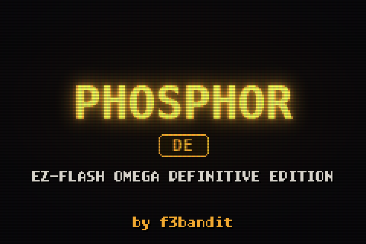
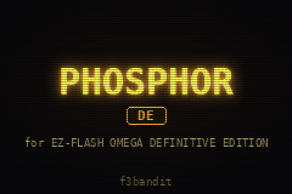
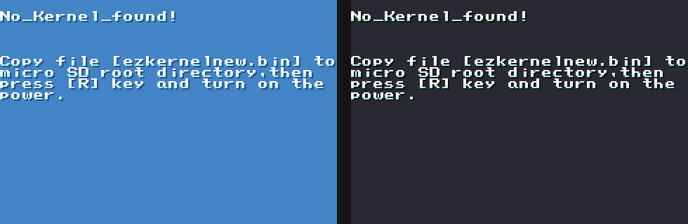

# Phosphor_DE

A custom kernel (the menu/firmware you see when you turn the cart on) for the **EZ-Flash Omega Definitive Edition** GBA flash cart, by **f3bandit**.

Dark, readable, GBA-only, with a new cheat engine and a ready-made cheat pack of **28,642 cheats for 1,700 games**, every one ready to play with nothing to type in.





> **Read the [disclaimer](#disclaimer) before flashing anything.** You flash your cart at your own risk.

---

## Contents
- [Which carts it works on](#which-carts-it-works-on)
- [Features](#features)
- [Quick start (install)](#quick-start-install)
- [SD card layout](#sd-card-layout)
- [Cheats](#cheats) (and [Supported codes](#supported-codes))
- [Buttons](#buttons)
- [Settings](#settings)
- [Loader recolor (optional)](#loader-recolor-optional)
- [Cart firmware (FPGA) and the white EZ-FLASH screen](#cart-firmware-fpga-and-the-white-ez-flash-screen)
- [Going back to the official kernel](#going-back-to-the-official-kernel)
- [What it doesn't do](#what-it-doesnt-do)
- [Tools in this repo](#tools-in-this-repo)
- [Building from source](#building-from-source)
- [Repo layout](#repo-layout)
- [Credits and licenses](#credits-and-licenses)
- [Disclaimer](#disclaimer)

---

## Which carts it works on

| Cart | Works? |
|---|---|
| EZ-Flash Omega **Definitive Edition, Rev B** (FPGA firmware 7) | **Yes. Tested and working on real hardware and on the Analogue Pocket.** |
| EZ-Flash Omega **Definitive Edition, Rev A** (firmware 5) | Should work: the kernel detects Rev A and Rev B the same way EZ-Flash's kernel does. **Not tested.** |
| EZ-Flash Omega Definitive Edition **B** (the newer blue board, "Rev.BLUE", official file `ezbluekernel.bin`) | **No.** Different kernel. Don't flash this on it. |
| Original EZ-Flash Omega (not Definitive Edition) | **No.** Different hardware and kernel (`ezkernel.bin`). |
| EZ-Flash IV, 3in1, Junior, Parallel, EZ-Flash Air, any other cart | **No.** |

Not sure which you have? On the official kernel the cart revision shows on screen. On Phosphor_DE it's on **Settings > About** (for example `Rev B (LX16) FW7`).

Phosphor_DE has been **tested and working on real hardware and on the Analogue Pocket**. It runs on anything that plays GBA carts: GBA, GBA SP, Game Boy Micro, DS/DS Lite (GBA slot), Game Boy Player and the Analogue Pocket.

---

## Features

### Menu
- Tabs: **SD**, **NOR**, **Recent**, **Settings**. L/R switches tabs.
- **GBA only.** The SD list shows folders and `.gba` / `.agb` files and nothing else, so there are no file-type icons.
- **Long names scroll** everywhere (file list, game card, Recent, cheat list). Made for romhacks and patched games with long names.
- **Readable**: Tamzen Bold font, light text on a dark grey background instead of white on black.
- **Game card**: box art, game code and save type, with these actions:
  - **Play**
  - **Play clean** (no add-ons: no cheats, savestates, sleep or reset-to-menu)
  - **Cheats**
  - **Write to NOR** / **Write to NOR clean**
  - save type on the d-pad
- **Recent** list of the games you played last.
- File names in any language (UTF-8). Accented letters are shown as plain letters.

### Tools built in
- **NOR Check**: press **START on the NOR tab** to test the 64 MB game NOR flash for dead cells. Good for catching a bad cart before it eats a save.
- **Boot chip dump**: press **START on Settings > About** to copy the cart's 8 MB boot chip to `/SYSTEM/DUMP` as two 8 MB files (`BOOT8000.BIN`, `BOOT8002.BIN`). It only **reads** the chip; it never writes to it. You need 16 MB free on the SD card.

### Kept from the EZ-Flash kernel
Everything that makes games run is EZ-Flash's own engine, unchanged in what it does:
- running games from SD (PSRAM) and from NOR
- saves on the SD card, with auto save and optional save backups
- savestates (in-game menu), reset to menu, sleep
- the game clock (RTC)
- LED settings
- DS **Mode B** (Rumble, RAM, Cart)

### Removed on purpose
- Plugins and emulators (NES, GB, SMS and the rest). Phosphor_DE is GBA only.
- EZ-Flash's cheat system and cheat library (replaced, see [Cheats](#cheats)).
- Chinese language support and full-screen background images.

---

## Quick start (install)

You need: the cart, a microSD card (FAT32), and a PC.

1. Download the latest **release zip** from the [Releases page](../../releases).
2. Unzip it. Copy everything inside the **`SD card`** folder to the **root** of your microSD card:
   - `ezkernelnew.bin`
   - the `SYSTEM` folder (it holds the cheat pack, `SYSTEM/CHEATS`)

   If the card already has a `SYSTEM` folder, merge them. Nothing of yours gets overwritten except old Phosphor_DE cheat files.
3. Put the SD card in the cart and the cart in your console.
4. **Hold R** while you turn the console on, and keep holding it until the update screen appears.
5. Let it finish. **Do not turn the power off while it writes.**
6. The console boots into Phosphor_DE. You can delete `ezkernelnew.bin` from the SD card afterwards (keep a copy on your PC).

`ezkernelnew.bin` for v0.1: 1,011,688 bytes, md5 `ea6c68266ac9495500f598d8653b5545`.

Optional extras:
- **Box art**: Phosphor_DE uses EZ-Flash's box art pack (`IMGS.zip` from EZ-Flash's site). Put its `IMGS` folder inside `SYSTEM`, so you have `SYSTEM/IMGS/A/X/AXVE.bmp` and so on. It isn't included here because it isn't ours to share.
- **Loader recolor**: `loader/de-recovery-phosphor.img` in the zip, see [Loader recolor](#loader-recolor-optional).

### Updating Phosphor_DE
Same steps with the new `ezkernelnew.bin`: copy it to the SD root, hold R at power-on. Your saves, settings and cheat picks stay.

---

## SD card layout

```
SD card root
├── ezkernelnew.bin              only needed when installing/updating (hold R at power-on)
├── BACKUP/
│   └── SAVER/                   save backups (when Settings > Saves > Back up saves is on)
├── SYSTEM/
│   ├── CHEATS/                  cheat pack: one file per game, named by game code
│   │   ├── BPEE.cht             cheats for Pokemon Emerald (USA)
│   │   └── BPEE.sel             your picks for that game (made by Phosphor_DE)
│   ├── IMGS/                    box art (optional, EZ-Flash's IMGS pack)
│   │   └── B/P/BPEE.bmp
│   ├── SAVER/                   game saves
│   ├── RTS/                     savestates
│   ├── PATCH/                   per-game patch cache made by the engine
│   ├── DUMP/                    boot chip dump (only after you run it)
│   └── RECENT.TXT               the Recent list
└── your games, in any folders you like (.gba)
```

Phosphor_DE makes the folders it needs by itself. The only ones you copy are `SYSTEM/CHEATS` (and `SYSTEM/IMGS` if you want box art).

The **game code** is the 4-letter code inside every GBA ROM (Pokemon Emerald USA is `BPEE`). Cheats and box art are found by that code, so the ROM's file name doesn't matter.

---

## Cheats

The cheat system is new; EZ-Flash's was dropped because its library is badly organized and a lot of its codes are unreliable.

### Using them
1. Pick a game, open its card, choose **Cheats**.
2. **A** turns a cheat on or off, **SELECT** turns all off, **L/R** pages, **B** is done.
3. Play. The card shows how many cheats are on. Your picks are remembered per game (`.sel` file).
4. **Play clean** on the card starts the game with no cheats (and no other add-ons).

- Cheats marked **auto** ("Anti DMA", "Must Be On") switch on by themselves whenever any other cheat is on. Some games (Pokemon in particular) move their data around in memory, and their codes only hit the right place with Anti DMA on.
- A cheat marked **n/a** is one the engine can't run. The included pack has none.
- A cheat whose name ends in **(Rev 0)** or **(Rev 1)** fits only that revision of the game (FireRed and LeafGreen 1.0 and 1.1 share a game code but not their code). Phosphor_DE reads the revision from the ROM and lists only the cheats that fit it.
- Cheats can be turned off in-game from the in-game menu, and switched off entirely in **Settings > Add-ons > Cheats**.
- Up to **448 cheats per game** are listed.

### The cheat pack (`SYSTEM/CHEATS`)
- **1,700 games, 28,642 cheats**, from **GameHacking.org** (all GBA games) and the **libretro cheat database**, merged per game code.
- **Ready to play only.** Every cheat works the moment you turn it on:
  - codes where you'd have to type in a value (`XXXX`, `??`) are **removed**, along with GameHacking's long "pick a value" lists made from them. Normal codes already have the value set (like 9999 gold).
  - master / "must be on" codes are removed: Phosphor_DE doesn't need them. Anti-DMA fixes are kept.
  - Action Replay and GameShark codes are converted to plain Code Breaker, decrypted where needed.
  - every file was compiled with the Phosphor_DE cheat engine itself; anything it couldn't run was removed.
  - the whole pack is audited (`tools/audit_pack.py`): "Modifier" and plain "Slot N" codes whose value was lost, codes that only check a condition and write nothing, ROM patches past the end of the game, writes to the BIOS stack area and impossible button checks are removed; names are cleaned up (no HTML codes or characters the cart's font can't show).
  - games with two revisions under one game code (Super Mario Advance 4, Advance Wars, FireRed, LeafGreen) get their revision-specific cheats tagged `(Rev 0)` / `(Rev 1)`, so the cart only lists the ones that fit your ROM.
  - **Final Fantasy (I&II, IV, V, VI, Tactics Advance) and Fire Emblem** were gone through code by code: GameHacking "set slot to X" lists whose X was lost (they wrote 0 into every slot every frame, deleting items, units and classes) and item lists decoded with the wrong key (random writes into the game's code) were removed.
  - **Pokemon Ruby, Sapphire, FireRed, LeafGreen and Emerald (USA)** were checked against byte-exact builds of the games (pret's decompilations): every ROM patch against the instruction it changes, every RAM address against the variable it hits. Broken ones were removed, FireRed/LeafGreen get the right Anti DMA for each revision, and Anti DMA also keeps the money key at 0, so money, coin and item-count cheats give real amounts.
- What was left out, game by game and why: [`cheats/CHEATS_REPORT.txt`](cheats/CHEATS_REPORT.txt).
- Where it came from: [`cheats/CHEATS_SOURCE.txt`](cheats/CHEATS_SOURCE.txt).
- Which code types the engine runs: [Supported codes](#supported-codes) (also in the pack as `SUPPORTED_CODES.txt`).

### Cheat file format
Plain text, one file per game, `SYSTEM/CHEATS/<GAMECODE>.cht`. Two layouts are read:

RetroArch layout (what the pack uses), from `BPEE.cht` (Pokemon Emerald USA):
```
cheats = 2

cheat0_desc = "Anti DMA"
cheat0_code = "88076BEA+2400+88076CD6+2400"
cheat0_enable = false

cheat1_desc = "1-Hit Kill [Hold L]"
cheat1_code = "74000130+01FF+8202479A+0000+74000130+01FF+8202479C+0000"
cheat1_enable = false
```

Plain text, as pasted from GameHacking.org (a name line, then code lines):
```
Anti DMA
88076BEA 2400
88076CD6 2400
1-Hit Kill [Hold L]
74000130 01FF
8202479A 0000
74000130 01FF
8202479C 0000
```

### Supported codes

The cart runs **unencrypted Code Breaker** codes: lines of 8 + 4 hex digits (`XXXXXXXX YYYY`), where the first digit is the code type. Every cheat in the pack uses only the supported types below; the pack builder compiles each file with the engine and drops anything it can't run. The same list ships with the pack as [`SUPPORTED_CODES.txt`](cheats/SUPPORTED_CODES.txt).

| Type | Line | What it does | Supported |
|---|---|---|---|
| `0`, `1` | `0xxxxxxx yyyy` | game ID / hook lines of master codes | ignored (not needed) |
| `2` | `2aaaaaaa vvvv` | 16-bit OR (set bits) | yes |
| `3` | `3aaaaaaa 00vv` | 8-bit write | yes |
| `4` | `4aaaaaaa vvvv` + `iiiinnnn ssss` | fill / slide: write `v` `n` times, value +`i`, address +`s` each time | yes |
| `5` | `5aaaaaaa nnnn` + data lines | write a list of `n` halfwords (3 per data line, byte-swapped) | yes |
| `6` | `6aaaaaaa vvvv` | 16-bit AND (clear bits) | yes |
| `7` | `7aaaaaaa vvvv` | if 16-bit value **=** `v`, run the next code | yes |
| `8` | `8aaaaaaa vvvv` | 16-bit write to RAM | yes |
| `8` | `8800xxxx vvvv` (address `0x08xxxxxx`) | ROM patch, applied once when the game starts | yes (not after a condition) |
| `9` | `9xxxxxxx yyyy` | encryption seed (encrypted Code Breaker) | **no** |
| `A` | `Aaaaaaaa vvvv` | if 16-bit value **≠** `v`, run the next code | yes |
| `B` | `Baaaaaaa vvvv` | if 16-bit value **>** `v` (unsigned) | yes |
| `C` | `Caaaaaaa vvvv` | if 16-bit value **<** `v` (unsigned) | yes |
| `D` | `D0000020 kkkk` | if buttons `k` are held, run the next code | yes (only `D0000020`) |
| `E` | `Eaaaaaaa vvvv` | 16-bit ADD | yes |
| `F` | `Faaaaaaa vvvv` | if (16-bit value AND `v`) ≠ 0, run the next code | yes |

- **Addresses:** RAM writes and conditions `0x02000000`-`0x07FFFFFF` (EWRAM, IWRAM, I/O, palette, VRAM, OAM); ROM patches `0x08000000`-`0x09FFFFFF`.
- A condition (`7`, `A`, `B`, `C`, `D`, `F`) covers the whole next code, including every line of a fill or list.
- Codes run on every interrupt while cheats are on; ROM patches are applied when the game starts.
- **Not supported on the cart** (convert on a PC first; `tools/gbacodes.py` does it): encrypted Code Breaker (codes starting with a `9` line), Action Replay v3 / AR MAX and GameShark v1/v2 codes (8 + 8 digits, encrypted or raw), codes with a value left to type in (`XXXX`, `??`), `D` codes other than `D0000020`.
- **Revisions:** a cheat named `... (Rev N)` is listed only for that revision of the game.
- **Auto codes:** a cheat whose name contains "Anti DMA", "Anti-DMA" or "Must Be On" switches on by itself with any other cheat, and sits at the top of the list.
- **Limits:** 448 cheats listed per game. The cheats switched on together compile to engine entries (one per write or condition, 2 per fill, one per halfword of a list; ROM patches don't count). The list holds up to 2,900, and the room left in the in-game patch area (about 21 KB of VRAM) can make the real limit lower; the cart warns "Too many codes on" when it's hit.

### Adding your own
Write the codes into `SYSTEM/CHEATS/<GAMECODE>.cht` in either layout above. To convert Action Replay / GameShark codes, use `tools/gbacodes.py` (see [Tools](#tools-in-this-repo)).

---

## Buttons

| Where | Button | Does |
|---|---|---|
| Power-on | hold **R** | install / update the kernel from `ezkernelnew.bin` |
| Power-on | hold **SELECT** | EZ-Flash safe mode (loader update / recovery, see below) |
| Menu | **L / R** | switch tabs |
| Menu | **A / B** | open / back |
| NOR tab | **START** | NOR Check |
| Settings > About | **START** | dump boot chip |
| Cheat list | **A** / **SELECT** / **L R** / **B** | on-off / all off / page / done |
| In game | **L + R + START** | in-game menu (savestates, cheats on/off) or reset to menu, depending on Settings > Add-ons |
| In game | **L + R + SELECT** | sleep (when Settings > Add-ons > Sleep is on) |

---

## Settings

| Section | Options |
|---|---|
| Add-ons | Reset to menu, Savestates, Sleep, Cheats, Patch engine (Normal / Fast) |
| Saves | Auto save, Back up saves |
| Clock | Game clock (RTC) |
| Display | Box art, Reset type (Soft / Hard) |
| LED | LED on/off, breathing and SD-activity colors |
| Mode B | DS Mode B: Rumble / RAM / Cart |
| About | version, cart revision and firmware, boot chip dump |

---

## Loader recolor (optional)

**Why it exists:** the cart's **loader** (the screens you get while installing a kernel, "EZ-FLASH UPDATE MODE", "No kernel found") is a bright, eye-searing blue, and it was stupid next to a dark kernel. So this changes it to Phosphor grey.



The loader is separate from the kernel and lives in the same boot chip, at the very start. It is updated through EZ-Flash's **safe mode** with EZ-Flash's own recovery image. The recolor changes **exactly 4 bytes** of that image: two color values. No code is touched.

The ready-made image is in the release zip and in this repo: [`loader/de-recovery-phosphor.img`](loader/de-recovery-phosphor.img), md5 `557c6e79ad576c3054785bd27fa65340`.

1. Write `de-recovery-phosphor.img` to a **spare** microSD card with **Win32 Disk Imager** (it wipes that card; Rufus may refuse the image).
2. Put that card in the cart, **hold SELECT** while turning on (safe mode), choose **Update Loader**, and wait for 100%. Don't turn the power off while it writes.
3. Put your normal SD card back.

Want to make it yourself? `loader/patch_loader.py` builds the same file from your own copy of EZ-Flash's `de-recovery.img` (the **Omega DE** one, not the original Omega one) and checks the md5 before and after:
```
python loader/patch_loader.py de-recovery.img de-recovery-phosphor.img
```

**To undo it:** do the same with EZ-Flash's original `de-recovery.img`. Safe mode is separate from the loader and isn't changed, so this way back always stays available.

---

## Cart firmware (FPGA) and the white EZ-FLASH screen

- The cart also has **FPGA firmware** (Rev B: FW7, Rev A: FW5). Phosphor_DE **never writes the FPGA firmware**. If your cart's firmware is older than the latest, Phosphor_DE shows a page saying so; install EZ-Flash's official kernel once to update it, then reinstall Phosphor_DE.
- The kernel occupies the boot chip from `0x40000` up to about `0x137000`. The FPGA firmware sits much higher (from `0x1D5000`), so installing Phosphor_DE never touches it.
- The **white "EZ-FLASH" screen** at power-on comes from the FPGA firmware, not the kernel or the loader. It can't be changed without changing the FPGA firmware, and that isn't worth the risk, so it stays.

---

## Going back to the official kernel

Download EZ-Flash's official Omega DE kernel, put its `ezkernelnew.bin` on the SD root, hold R at power-on. Your saves stay. EZ-Flash's kernel ignores `SYSTEM/CHEATS`.

---

## What it doesn't do

- No emulators or plugins (no NES, GB, GBC, SMS, PCE...). GBA only.
- No EZ-Flash cheat library (`SYSTEM/CHEAT`); it uses `SYSTEM/CHEATS` instead.
- No encrypted Code Breaker codes on the cart (about 1,400 such codes on GameHacking.org aren't in the pack).
- No box art in the release (use EZ-Flash's IMGS pack).
- No Chinese UI.
- Can't change the white EZ-FLASH power-on screen (see above).
- Doesn't update the cart's FPGA firmware (use the official kernel for that).

---

## Tools in this repo

All PC-side, nothing here runs on the cart.

| Tool | What it does |
|---|---|
| `tools/gba-cheat-downloader/` | **GBA Cheat Downloader**, a browser extension (Brave, Chrome, Edge). Downloads the cheats for every GBA game on GameHacking.org into one zip. See below. |
| `tools/make_gh_pack.py` | Builds the cheat pack from that zip plus the libretro pack: drops XXXX codes and value lists, converts and decrypts codes, checks every file with the real engine, writes `SYSTEM/CHEATS` and the report. |
| `tools/make_cheat_pack.py` | Builds a cheat pack from the libretro cheat database (game codes from the No-Intro GBA dat). |
| `tools/gbacodes.py` | Converts Action Replay v3 / AR MAX and GameShark v1/v2 codes (encrypted or raw) to the plain Code Breaker that Phosphor_DE runs. |
| `tools/audit_pack.py` | Checks a whole cheat pack the way the engine reads it and lists anything harmful or useless (BIOS stack writes, ROM patches past the end of the game or at odd addresses, conditions with nothing after them, impossible button checks, value-list leftovers, bad names). The pack builder applies its findings. |
| `tools/cht_check.c` | The Phosphor_DE cheat parser and compiler built for the PC, used to check cheat files. |
| `loader/patch_loader.py` | Makes the loader recolor image from EZ-Flash's `de-recovery.img` (above). |
| `tools/make_sim_disk.sh` | Makes the test SD card for the emulator build. |
| `tools/bdf2font.py` | Turns a BDF font into the kernel's font header. |

### GBA Cheat Downloader (browser extension)
GameHacking.org sits behind Cloudflare, so the download has to run in your own browser.

Install once:
1. Open `brave://extensions` (Chrome: `chrome://extensions`, Edge: `edge://extensions`).
2. Turn on **Developer mode** (top-right).
3. Click **Load unpacked** and select the `tools/gba-cheat-downloader` folder.
4. Pin it: puzzle-piece icon next to the address bar > pin **GBA Cheat Downloader**.

Use:
1. Click the gold **GBA** button. It opens gamehacking.org (pass the Cloudflare check if it shows one, then click the button again).
2. Click **Start** in the box at the bottom-right. Keep the tab open; about 1,500 games take 20-30 minutes.
3. When it's done, a Save window opens: choose where to save `gba_cheats_gamehacking.zip`.

### Rebuilding the cheat pack
```
python tools/make_cheat_pack.py <libretro-database folder> libretro_pack
python tools/make_gh_pack.py gba_cheats_gamehacking.zip libretro_pack <libretro-database folder> out
```
`out/SYSTEM/CHEATS` is the pack; `out/CHEATS_REPORT.txt` lists everything dropped. Needs Python 3 and gcc (for the engine check). The libretro database is https://github.com/libretro/libretro-database.

---

## Building from source

Needs devkitPro with devkitARM and libgba.

- Windows: `build.bat` (msys2 from devkitPro).
- Linux/macOS: `make`.

Output: `ezkernelnew.bin`. The build stops if the kernel is over 2 MB or its RAM data overflows. Building v0.1 from this repo gives the exact released file (md5 above).

Emulator build for testing in mGBA (never flash this):
```
sh tools/make_sim_disk.sh     # needs mtools and dosfstools
make SIM=1                    # -> phosphor_de_sim.gba with the test SD card from sim/root built in
```

### Building on GitHub and making a release
Two GitHub Actions, both started by hand only (they use no Actions minutes otherwise):

**Build** (`.github/workflows/build.yml`): builds `ezkernelnew.bin` from the current source with devkitARM release 65 (it refuses any other toolchain release), runs the same 2 MB / RAM safety checks, and posts the file as a download on the run page (Artifacts). The run summary shows whether it matches `dist/ezkernelnew.bin`. It never releases anything or changes the repo.

**Release** (`.github/workflows/release.yml`):
1. Put the tested kernel in `dist/ezkernelnew.bin` (and the new pack in `sdcard/SYSTEM/CHEATS` if it changed), commit and push.
2. **Actions** tab > **Release** > **Run workflow**, type the version (e.g. `v0.2`), Run.

So a new version goes: change the source, run **Build**, test its `ezkernelnew.bin` on the cart, copy it to `dist/`, commit, run **Release**.

It ships the committed, cart-tested `dist/ezkernelnew.bin` (it doesn't rebuild it), packs `Phosphor_DE_<version>.zip` (the `SD card` folder, the loader patcher, README, licenses), and creates the tag and the release. The release text comes from `release/NOTES.md` and the zip's README from `release/README.txt`.

---

## Repo layout

```
source/        kernel source (pde_*.c is the Phosphor_DE UI, cheats and tools; the rest is the EZ-Flash engine)
  norcheck/    NOR Check and the UI drawing code
  ff15/        FatFs
images/        graphics headers used by the build
art/           splash screen and its generator
fonts/         font licenses
sdcard/        the SD card files (SYSTEM/CHEATS)
cheats/        cheat pack source and report
dist/          prebuilt ezkernelnew.bin
tools/         PC tools (see above)
sim/           test SD card contents for the emulator build
docs/          pictures for this README
release/       release notes and the release zip's README (used by the Release action)
.github/       the Build and Release actions
```

---

## Credits and licenses

**Phosphor_DE** by f3bandit. Licensed under the **Apache License 2.0** ([LICENSE](LICENSE)).

It is built on, and includes:
- **EZ-Flash Omega Definitive Edition kernel** (the engine that runs games), © EZ-Flash, Apache License 2.0.
- **FatFs** by ChaN (its own permissive license, in `source/ff15`).
- **Goomba Color** and **PocketNES** binaries, which ship inside EZ-Flash's kernel source (not used by Phosphor_DE's GBA-only menu).
- **Tamzen** font (Suraj N. Kurapati, based on Tamsyn by Scott Fial) and **Spleen** font (Frederic Cambus); licenses in `fonts/`.

Cheat data (not covered by Apache 2.0):
- **GameHacking.org** (https://gamehacking.org), GBA code exports.
- **libretro cheat database** (https://github.com/libretro/libretro-database), CC BY-SA 4.0.

Tools: the Action Replay / GameShark decryption tables in `tools/_par_tables.py` and `tools/_gsa_tables.py` come from **mGBA** (© Jeffrey Pfau, Mozilla Public License 2.0).

EZ-Flash, Game Boy Advance, Analogue Pocket and all game names are trademarks of their owners. This project isn't affiliated with or endorsed by EZ-Flash, Nintendo, Analogue, GameHacking.org or libretro.

See [NOTICE](NOTICE) for the full list.

---

## Disclaimer

**Use this at your own risk.**

Phosphor_DE is unofficial software. Flashing a kernel or loader writes to your cart's boot chip, and anything that interrupts it (power loss, a bad SD card, the wrong file, the wrong cart) can leave the cart unbootable. Cheats write directly to a game's memory and can corrupt saves or crash games.

This software is provided **"AS IS", WITHOUT WARRANTY OF ANY KIND**, express or implied, including but not limited to the warranties of merchantability, fitness for a particular purpose and non-infringement. **In no event shall the author or contributors be liable** for any claim, damages or other liability, including damage to your cart, console, SD card or save data, lost data, or any other loss, whether in contract, tort or otherwise, arising from or in connection with this software or its use. See sections 7 and 8 of the Apache License 2.0.

Before you flash:
- Make sure your cart is an **Omega Definitive Edition** (not the original Omega, not the newer blue "DE B").
- Use a good battery or the power adapter, and don't touch anything while it writes.
- Back up the `SYSTEM/SAVER` folder (your saves).
- Know the way back: the official kernel (hold R) and EZ-Flash's loader recovery (hold SELECT).

Use only games you own.
